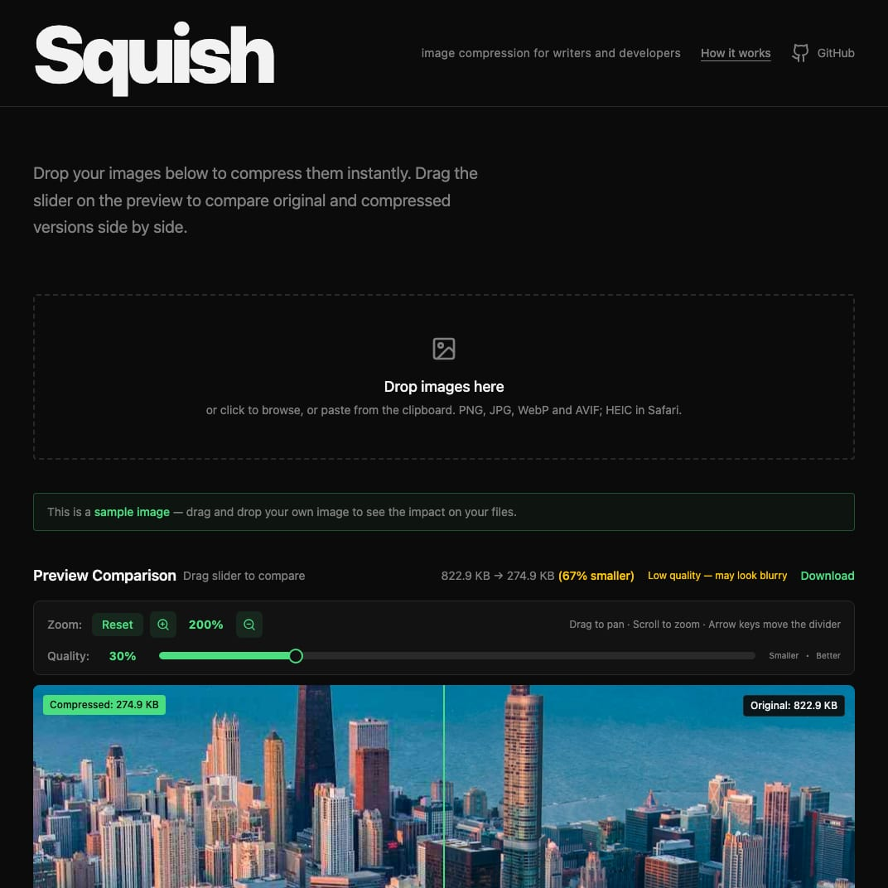
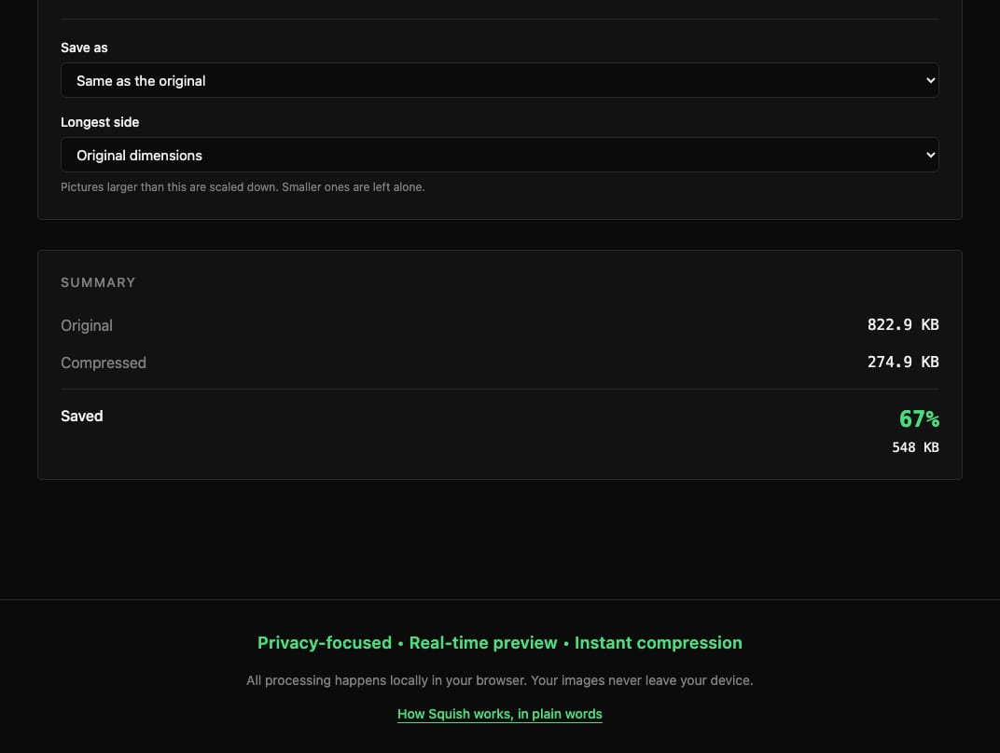
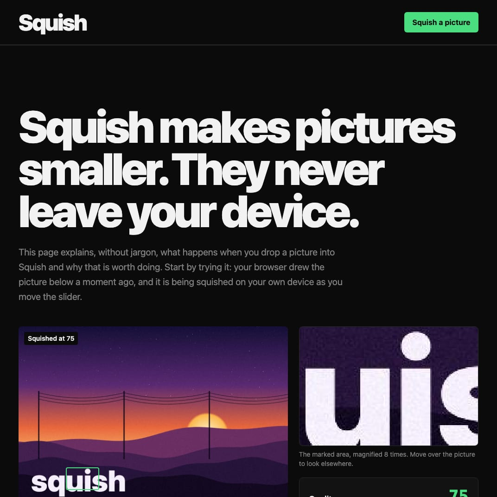
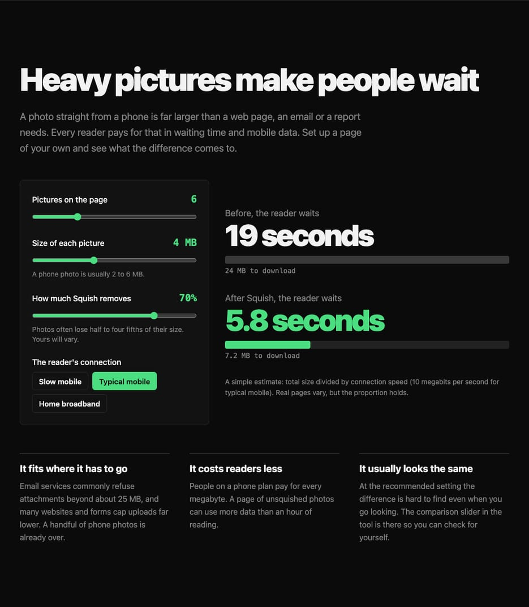
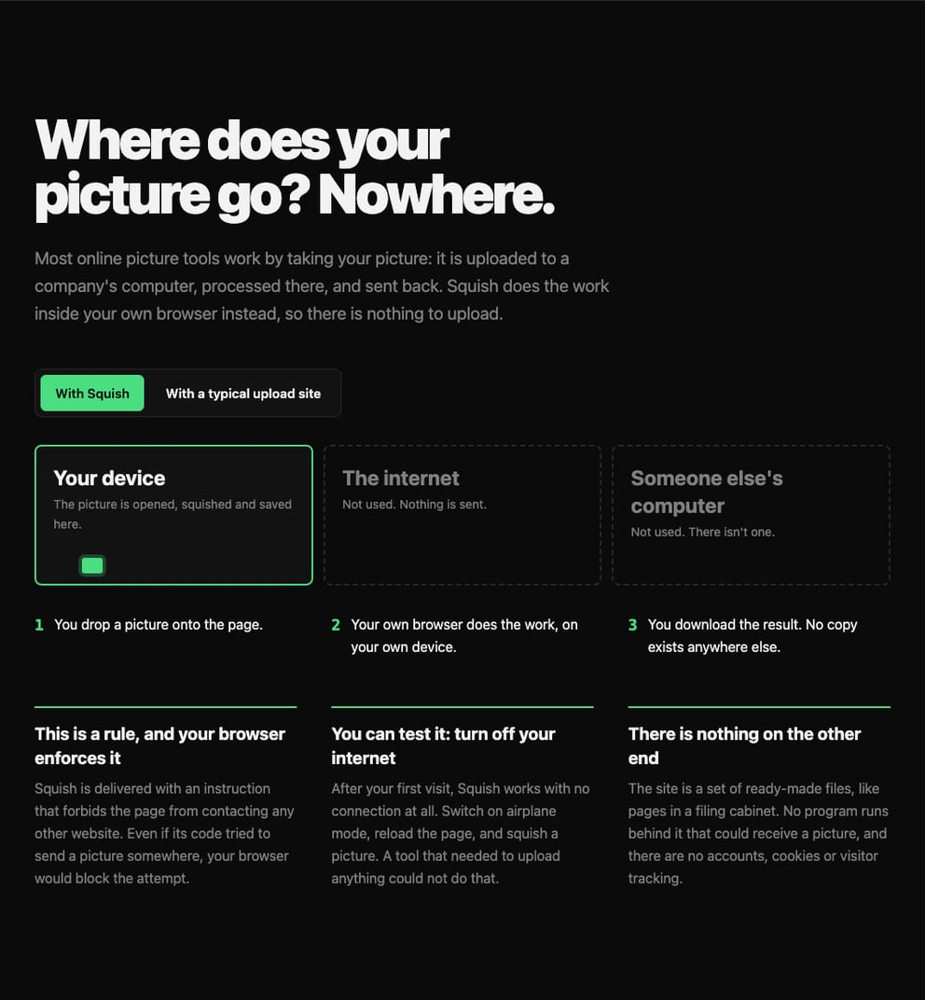
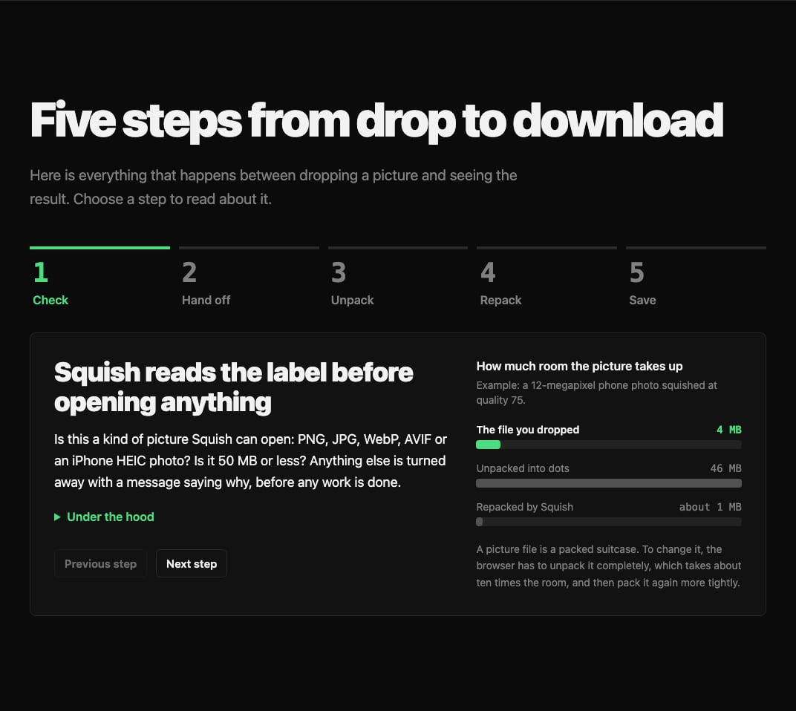

# Squish

[](https://opensource.org/licenses/MIT)
[](https://nuxt.com/)
[](https://vuejs.org/)
[](https://www.typescriptlang.org/)
[](https://ui.nuxt.com/)
[](https://nuxtseo.com/)

> **Image compression for writers and developers**

Squish makes pictures smaller inside your own browser. You drop in a picture, pick a quality, optionally change its format or dimensions, compare the result against the original with a slider, and download it. Nothing is uploaded: the site has no server program to upload to, its security policy forbids the page from contacting any other website, and after the first visit it works with no internet connection at all.

Live at **[squish.icjia.app](https://squish.icjia.app/)**. A plain-language, interactive explanation of how it works is at **[squish.icjia.app/technical-details](https://squish.icjia.app/technical-details)**.

## Contents

- [Screenshots](#screenshots)
- [Features](#features)
- [Quick start](#quick-start)
- [How it works](#how-it-works)
- [Known limits](#known-limits)
- [Tech stack](#tech-stack)
- [Testing](#testing)
- [Project structure](#project-structure)
- [Deployment](#deployment)
- [Security and accessibility audits](#security-and-accessibility-audits)
- [Contributing](#contributing)
- [License](#license)

## Screenshots

### The tool

The sample image loaded at quality 30, with the comparison slider and zoom controls.



The controls: quality, output format, longest side, and a running total of what was saved.



### The technical details page

A live demo opens the page: the browser draws a picture, then compresses it on the device as the slider moves. The panel on the right magnifies part of it eight times.



A calculator for what unsquished pictures cost a reader in waiting time.



Where a picture travels with Squish compared with a typical upload site.



The five steps from drop to download, and how much room the picture takes up at each.



## Features

- **Private by construction**: all processing happens in the browser. The Content Security Policy lists no third-party host, so the page cannot send data elsewhere.
- **Works offline**: after the first visit the tool runs with no connection, and can be installed as an app. Turning on airplane mode and squishing a picture is the simplest proof that nothing is uploaded.
- **Live comparison**: a divider between the original and the compressed picture, moved by mouse, touch or the arrow keys.
- **Zoom and pan**: 100% to 800% with the buttons or the mouse wheel; drag to pan when zoomed in.
- **Real-time quality control**: a 10 to 100 quality slider, with the new size and saving shown as you move it and colour-coded warnings at low settings.
- **Format conversion**: keep the original format, or save as JPG or WebP. This is how a PNG gets much smaller.
- **Resizing**: scale large pictures down to a chosen longest side, from 2,560 px to 800 px.
- **Five input formats**: PNG, JPG, WebP and AVIF everywhere; HEIC (iPhone photos) in Safari.
- **Three ways in**: drag and drop, the file picker, or paste from the clipboard.
- **Batch processing**: add several pictures and download them individually or together as one ZIP file.
- **Sample image**: try the tool without a file of your own. The sample is served from the site itself.
- **Technical details page**: an interactive, jargon-free explanation at `/technical-details`, with a live compression demo, a load-time calculator, a privacy diagram, a step-by-step walkthrough and a rounding demo.
- **Dark, responsive, accessible**: no sideways scroll from 320 px up; both pages pass axe-core at WCAG 2.1 AA with zero violations.

## Quick start

Requires Node.js 22.22.3 or later (Nuxt 4.6 refuses to install on older 22.x releases; `.nvmrc` pins a known-good version) and yarn.

```bash
git clone https://github.com/ICJIA/icjia-squish-2026.git
cd icjia-squish-2026
yarn install
yarn dev
```

The app is then at `http://localhost:3000`.

```bash
yarn generate   # build the static site into dist/
yarn preview    # preview the build
```

`yarn dev` sends no security headers and runs no service worker. To check a change against the production Content Security Policy:

```bash
yarn generate
yarn serve:dist   # serves dist/ with the headers from netlify.toml on port 4391
```

## How it works

1. **Check**: the file must be PNG, JPG, WebP, AVIF or HEIC, and 50 MB or less. Anything else is refused with a message and never added to the list.
2. **Hand off**: the work goes to a Web Worker (`public/compression-worker.js`) so the page stays responsive. One worker serves the whole page and keeps recently decoded pictures (up to 80 megapixels in total), so changing the quality re-encodes without decoding again. Browsers without `OffscreenCanvas` do the same work on the main thread.
3. **Unpack**: `createImageBitmap()` decodes the picture and it is drawn onto a canvas, scaled down if a longest side was chosen. A picture of more than 100 megapixels is refused at this point.
4. **Repack**: `convertToBlob()` re-encodes with the browser's own JPEG, WebP or PNG encoder at the chosen quality. By default the picture keeps its format; AVIF and HEIC, which browsers cannot write, become JPG.
5. **Save**: the result is held in memory as a Blob for the comparison slider and for download as `<name>_compressed.<ext>`. Several pictures are packed into `squish-images.zip` by a small ZIP writer in `app/utils/zip.ts`. The original file is never modified.

Changing the quality, format or size recompresses every picture after a 150 ms pause.

## Known limits

- **PNG output ignores the quality slider.** PNG is lossless, so the browser's encoder has no quality setting. The tool shows a note when this applies and suggests saving as JPG or WebP.
- **HEIC opens only where the browser can decode it.** Today that is Safari. In Chrome, Edge and Firefox a HEIC photo is refused with a message that says so. This was tested only through the refusal path; it has not been tested in Safari.
- **Output is JPG, WebP or PNG.** Browsers cannot write AVIF or HEIC.
- **Metadata is removed.** Because only the pixels are saved, EXIF data (camera model, time, GPS position) and embedded colour profiles do not survive. This is usually desirable for sharing, but it is not optional.
- **Transparency becomes white in a JPG.** JPG has no transparency.
- **GIF, SVG and TIFF are refused.**

## Tech stack

- **[Nuxt 4](https://nuxt.com/)** with **[Vue 3](https://vuejs.org/)** and **[TypeScript](https://www.typescriptlang.org/)**, pre-rendered to static files with `nuxt generate`
- **[Nuxt UI 4](https://ui.nuxt.com/)** on **[Tailwind CSS 4](https://tailwindcss.com/)**, with Lucide icons compiled into the bundle at build time
- **[Nuxt SEO](https://nuxtseo.com/)** for the sitemap, robots.txt and meta tags
- **Canvas API** and a **Web Worker** for compression; no compression library is shipped
- **[Vite PWA](https://vite-pwa-org.netlify.app/frameworks/nuxt)** (Workbox) for the offline service worker and web app manifest
- **[Vitest 4](https://vitest.dev/)** with happy-dom and Vue Test Utils for unit tests
- **[Playwright](https://playwright.dev/)** for browser tests against the built site
- **[Netlify](https://www.netlify.com/)** static hosting; **GitHub Actions** for CI

## Testing

```bash
yarn test              # 146 unit tests
yarn test:e2e          # build the site, then run 25 browser tests against it
yarn test:e2e:only     # browser tests against an existing dist/
yarn test:watch        # unit tests in watch mode
yarn test:coverage     # unit tests with a coverage report
yarn lint              # ESLint
yarn typecheck         # vue-tsc
```

The browser tests need a one-time `npx playwright install chromium`.

### Unit tests (Vitest)

| Test file | Tests |
|-----------|-------|
| `composables/useImageCompression.test.ts` | 39 |
| `components/ComparisonSlider.test.ts` | 32 |
| `components/QualityIndicator.test.ts` | 24 |
| `components/ImageCompressor.test.ts` | 21 |
| `utils/zip.test.ts` | 12 |
| `utils/explainers.test.ts` | 11 |
| `utils/structuredData.test.ts` | 7 |

Statement coverage, measured 2026-11-10: `QualityIndicator.vue` 100%, `ImageCompressor.vue` 72%, `useImageCompression.ts` 62%, `ComparisonSlider.vue` 59%, `components/tech/*.vue` 0%. happy-dom has no `OffscreenCanvas`, so the unit tests exercise the main-thread path; the worker, the service worker and the technical details components are covered by the browser tests instead.

### Browser tests (Playwright)

These run in Chromium against `dist/`, served by `scripts/serve-dist.mjs` with the security headers from `netlify.toml`, so anything the production Content Security Policy would block fails the test.

| File | Tests | What it checks |
|------|-------|----------------|
| `e2e/tool.spec.ts` | 15 | Sample image with no request to another host and no console errors; every icon drawn; format conversion (the downloaded file really is WebP); resizing; ZIP download; refusal of unsupported files; paste; keyboard control of the divider and thumbnails; no sideways scroll at 320, 375, 768 and 1,366 px |
| `e2e/technical-details.spec.ts` | 9 | The live demo, the calculator, the privacy diagram, the step walkthrough and the rounding demo all respond; no sideways scroll |
| `e2e/offline.spec.ts` | 1 | After one visit, with the network switched off: the page reloads, a picture is compressed, and the technical details page opens |

### Continuous integration

`.github/workflows/ci.yml` runs lint, type check, unit tests, the build and the browser tests on every pull request and on every push to `main`.

## Project structure

```
icjia-squish-2026/
├── app/
│   ├── assets/css/main.css          # Theme tokens and shared styles
│   ├── components/
│   │   ├── ImageCompressor.vue      # The tool: upload, settings, state, download
│   │   ├── ComparisonSlider.vue     # Before/after divider with zoom and pan
│   │   ├── QualityIndicator.vue     # Plain-language quality guidance
│   │   └── tech/                    # Sections of the technical details page
│   │       ├── LiveLab.vue          # Live compression demo
│   │       ├── LoadTime.vue         # Load-time calculator
│   │       ├── PrivacyRoute.vue     # Where a picture travels
│   │       ├── Pipeline.vue         # Five-step walkthrough
│   │       └── Rounding.vue         # How lossy compression works
│   ├── composables/
│   │   ├── useImageCompression.ts   # Validation, compression, worker management
│   │   └── useDebounce.ts
│   ├── pages/
│   │   ├── index.vue                # The tool
│   │   └── technical-details.vue    # How it works, in plain words
│   ├── utils/
│   │   ├── constants.ts             # Limits, formats and defaults
│   │   ├── zip.ts                   # ZIP writer for "Download all"
│   │   ├── demoScene.ts             # Draws the live demo's picture
│   │   ├── explainers.ts            # Pure helpers for the explainers
│   │   └── structuredData.ts        # schema.org JSON-LD
│   ├── app.config.ts
│   └── app.vue
├── public/
│   ├── compression-worker.js        # The Web Worker
│   ├── sample-cityscape.jpg         # Sample image, served locally
│   ├── pwa-*.png                    # Install icons
│   └── llms.txt
├── test/                            # Vitest unit tests, fixtures and helpers
├── e2e/                             # Playwright browser tests and fixtures
├── scripts/
│   ├── serve-dist.mjs               # Serves dist/ with netlify.toml's headers
│   ├── generate-pwa-icons.mjs       # Renders the install icons from favicon.svg
│   └── convert-og-image.mjs         # Renders og-image.svg to PNG
├── documentation/                   # Screenshots used in this README
├── docs/plans/                      # Design notes
├── .github/workflows/ci.yml         # Lint, type check, tests and build
├── nuxt.config.ts
├── netlify.toml                     # Build settings and security headers
├── playwright.config.ts
└── vitest.config.ts
```

## Deployment

Netlify builds with `yarn generate` and publishes `dist/`. `netlify.toml` sets:

- **Node 22.23.4** (pinned, matching `.nvmrc`) and the `netlify-static` Nitro preset
- **Content-Security-Policy** with no third-party host in any directive: `default-src 'self'`, `connect-src 'self'`, `img-src 'self' blob: data:`, `worker-src 'self'`, `object-src 'none'`, `base-uri 'self'`, `form-action 'self'`, `frame-ancestors 'none'`, `upgrade-insecure-requests`
- **HSTS**, `X-Frame-Options: DENY`, `X-Content-Type-Options: nosniff`, `Referrer-Policy`, `Permissions-Policy`, `Cross-Origin-Opener-Policy: same-origin` and `Cross-Origin-Resource-Policy: same-origin`

The build also writes `dist/_headers`, which gives the hashed files under `/_nuxt/` a one-year immutable cache.

The service worker (`sw.js`) precaches about 630 KB: both pages, their scripts and styles, the compression worker and the icons. The 823 KB sample image is not precached; it is stored the first time someone loads it. A new deploy replaces the cache automatically on the next visit.

A push to `main` triggers a production deploy. Pull requests get a Deploy Preview.

## Security and accessibility audits

> Last audited: 2026-11-10, for releases 1.5.0 and 1.5.1. Details of every finding are in [CHANGELOG.md](CHANGELOG.md).

### Security (red team / blue team)

| Severity | Found | Fixed | Mitigated or accepted |
|----------|-------|-------|-----------------------|
| Critical | 0 | 0 | 0 |
| High | 0 | 0 | 0 |
| Medium | 2 | 1 | 1 |
| Low | 5 | 5 | 0 |
| Informational | 3 | 0 | 3 |

| # | Severity | Finding | Outcome |
|---|----------|---------|---------|
| M1 | Medium | The sample image was fetched from `images.unsplash.com`, disclosing each visitor's IP address to a third party and requiring that host in the CSP's `img-src` and `connect-src`. | **Fixed.** The sample is served from the site. The CSP now names no third-party host. A browser test fails if any request leaves the site. |
| M2 | Medium | `yarn audit` reported 305 advisories (6 critical, 163 high) in build and test tooling. | **Mitigated.** Dependencies refreshed, and Vitest, happy-dom, sharp and Nuxt UI moved to their current major versions: 10 remain, none critical or high (8 moderate, 2 low). None of this code is shipped to visitors. See I2. |
| L1 | Low | No limit on pixel dimensions: a small file describing an enormous picture could exhaust memory and crash the tab. | **Fixed.** Pictures over 100 megapixels are refused, and the worker's cache of open pictures is capped at 80 megapixels. |
| L2 | Low | A Web Worker that never answered was never stopped. | **Fixed.** A job unanswered after 60 seconds stops the worker; the next job starts a fresh one. |
| L3 | Low | A dropped file of an unsupported type was added to the list before being refused, and stayed as a broken thumbnail. | **Fixed.** Files are validated before they are added; a picture that fails to compress is removed. |
| L4 | Low | Moving the quality slider quickly could let an older compression overwrite a newer one, and released a result's memory while it was still displayed. | **Fixed.** Each recompression run is numbered; stale results are discarded. |
| L5 | Low | No `Cross-Origin-Opener-Policy` or `Cross-Origin-Resource-Policy`; the CSP lacked `upgrade-insecure-requests`. | **Fixed.** All three added; `Permissions-Policy` widened. |
| I1 | Info | `script-src` and `style-src` allow `'unsafe-inline'`. | **Accepted.** Nuxt's static pages carry an inline hydration script. The site renders no user-supplied HTML (no `v-html`), and `connect-src 'self'` leaves an injected script nowhere to send data. |
| I2 | Info | The 10 remaining advisories: glob and minimatch inside build and test tools, deepmerge inside the service-worker build tool, and esbuild inside the font tooling that Nuxt UI brings in. | **Accepted for now.** All are build-time or test-time tools with no fixed release available through their parent packages yet. The Nuxt UI form-component advisory present in 1.5.0 was cleared in 1.5.1 by moving to Nuxt UI 4. |
| I3 | Info | New in 1.5.0: a service worker and a ZIP writer, both of which are new attack surface. | **Reviewed.** The service worker is same-origin only, caches only the site's own files, and needs no CSP change. File names written into a ZIP have folders and control characters removed, so an entry cannot be extracted outside its folder. |

**Blue team assessment.** The site is static files with no server-side code, no accounts, no cookies and no analytics. Input is validated by type, byte size and pixel count. No `v-html`, `eval` or dynamic script loading is used. The worker, the service worker and every asset are same-origin. Using Squish contacts no host other than the site itself, and that is now enforced by a test.

### Accessibility (axe-core 4.14, WCAG 2.0/2.1 A and AA plus best practices)

| Page and state | Violations before | Violations after |
|----------------|-------------------|------------------|
| Tool, empty | 0 | 0 |
| Tool, with an image loaded | 2 rules, 3 elements | 0 |
| Technical details, desktop | new page | 0 |
| Technical details, mobile | new page | 0 |

The March 2026 audit tested only the empty tool. Testing with an image loaded found white text on the green accent at about 1.8:1 contrast (the size badges and "Download all"), and Download and Remove buttons nested inside another button. Both are fixed. The comparison divider, which axe cannot assess, was mouse and touch only; it is now a keyboard-operable slider.

## Contributing

1. Fork the project
2. Create a branch (`git checkout -b feature/your-change`)
3. Run `yarn lint`, `yarn typecheck`, `yarn test` and `yarn test:e2e`
4. Open a pull request

## License

MIT. See [LICENSE](LICENSE).

The sample image is a photograph from [Unsplash](https://unsplash.com/) (photo ID `photo-1477959858617-67f85cf4f1df`), used under the Unsplash License.

## Contact

ICJIA, the Illinois Criminal Justice Information Authority.
